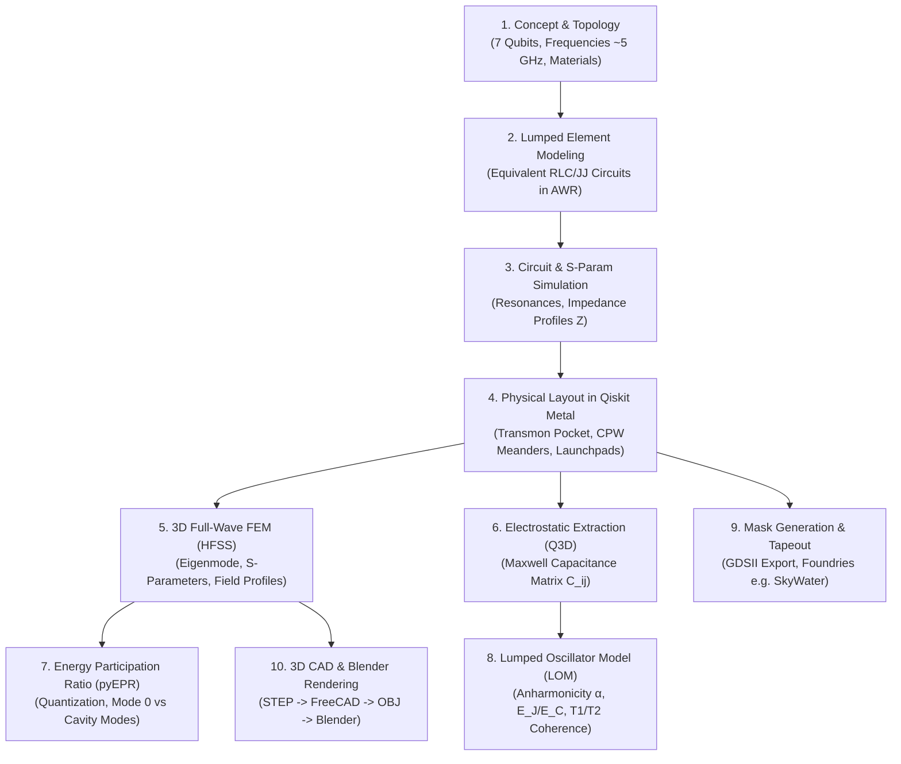
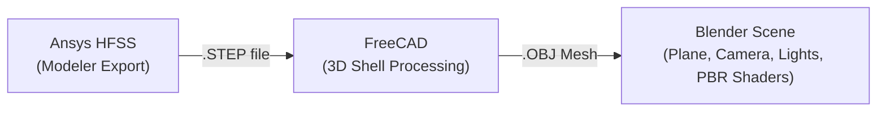

# Superconducting Quantum Hardware Chip Design: The Complete Qiskit Metal Guide & Q&A

This guide covers all concepts, equations, tools, and design workflows demonstrated in Simon Quantum Hardware's 56-minute masterclass: **"Quantum Computer Hardware Chip Design - Qiskit Metal"** (inspired by IBM's landmark paper, *"Hardware-efficient variational quantum eigensolver for small molecules and quantum magnets"*).

---

## 1. End-to-End Quantum Chip Design Lifecycle

The design of a superconducting quantum processor bridges macroscopic microwave engineering and microscopic quantum mechanics.



---

## 2. Theoretical Foundations: Superconducting Transmon Physics

### Why an LC Resonator is Not a Qubit
A classic superconducting LC circuit has equidistant energy levels ($E_n = \hbar \omega (n + \frac{1}{2})$). An incoming microwave drive at $\omega_0 = 1/\sqrt{LC}$ excites transitions $|0\rangle \to |1\rangle \to |2\rangle \to \dots$, causing leakage into higher non-computational states. It is a **harmonic oscillator**, not a two-level system.

### The Josephson Junction as a Non-Linear Inductor
By introducing a **Josephson Junction (JJ)**—a thin insulating barrier ($\sim 1-2\text{ nm}$ $\text{AlO}_x$) sandwiched between superconducting aluminum leads—we introduce a non-linear cosine potential:
$$H = 4 E_C (\hat{n} - n_g)^2 - E_J \cos(\hat{\phi})$$

- **Josephson Inductance:** $L_J = \frac{\Phi_0}{2\pi I_c \cos\phi} \approx \frac{\Phi_0}{2\pi I_c}$
- **Charging Energy:** $E_C = \frac{e^2}{2 C_\Sigma}$ (sets the electrostatic energy required to transfer one electron)
- **Josephson Energy:** $E_J = \frac{\hbar I_c}{2e} = \frac{\Phi_0 I_c}{2\pi}$

### The Transmon Regime ($E_J / E_C \gg 1$)
Traditional Cooper-Pair Boxes (CPB) suffered from high charge noise sensitivity. By shunting the junction with a large capacitor ($C_\Sigma \approx 50-100\text{ fF}$), we achieve:
$$\frac{E_J}{E_C} \approx 50 - 100$$
- **Charge Dispersion:** Decreases exponentially with $\sqrt{8 E_J / E_C}$, making the qubit insensitive to ambient charge noise ($n_g$ fluctuations).
- **Anharmonicity:** Retains negative anharmonicity $\alpha \approx -E_C / h \approx -200\text{ to } -300\text{ MHz}$, ensuring $\omega_{01} \neq \omega_{12}$, allowing selective microwave control of the computational subspace $\{|0\rangle, |1\rangle\}$.

---

## 3. Comprehensive Stage-by-Stage Q&A Breakdown

### Section 1: Architecture, Topology & IBM Benchmark

#### Q1: What is the specific architecture and qubit count of the chip designed in the video?
**Answer:**
The chip is an **IBM 7-qubit architecture** inspired by IBM's paper *"Hardware-efficient variational quantum eigensolver for small molecules and quantum magnets"*. It features:
1. **Six fixed-frequency transmons** positioned around the perimeter, each equipped with two coupling pin pads (Pad A and Pad B) for readout and qubit-qubit interaction.
2. **One central flux-tunable transmon** equipped with both coupling pads and a dedicated flux/charge bias line.
- **Operating Frequencies:** Qubits operate near **$5\text{ GHz}$**, while readout resonators operate in the **$6-7\text{ GHz}$** band to maintain the dispersive regime ($|\Delta| = |\omega_q - \omega_r| \gg g$).

#### Q2: Why is the central qubit made flux-tunable while the outer six are fixed-frequency?
**Answer:**
- **Minimizing Frequency Collisions:** Fixed-frequency transmons have longer intrinsic coherence times ($T_2^*$) because they lack magnetic flux noise channels.
- **Controlled Entanglement:** To execute two-qubit entangling gates (such as Cross-Resonance or parametric iSWAP/CZ gates) between the center and surrounding qubits, the central qubit's frequency must be dynamically tuned into or out of resonance/interaction bands using a local fast-flux bias line.
- **Reduced Line Count:** Making all 7 qubits flux-tunable would require 7 separate high-speed flux bias lines, increasing cryogenic thermal dissipation and crosstalk.

---

### Section 2: Lumped Element Circuit Modeling (AWR Microwave Office)

#### Q3: Why do we simulate a lumped element circuit in AWR before touching layout tools like Qiskit Metal?
**Answer:**
Electromagnetic field simulations (FEM) take hours. Lumped element circuit simulation in EDA tools (like AWR Microwave Office or Keysight ADS) takes seconds. It allows the designer to:
1. Validate the resonance frequencies ($\omega = 1/\sqrt{L C}$) of transmon shunts and coupling buses.
2. Verify transmission ($S_{21}$) and reflection ($S_{11}$) profiles.
3. Compute input impedance ($Z_{\text{in}}$) to ensure proper $50\,\Omega$ characteristic impedance matching.
4. Set baseline target parameters ($C_{\text{shunt}} \approx 45-50\text{ fF}$, $L_J \approx 15-20\text{ nH}$, coupling capacitors $C_c \approx 5\text{ fF}$).

#### Q4: Why did Simon replace the Josephson junction with a linear inductor in the AWR and HFSS linear simulations?
**Answer:**
- Standard frequency-domain FEM solvers (Ansys HFSS Driven Modal / Eigenmode) and linear circuit simulators solve Maxwell's linear wave equations and cannot directly integrate non-linear quantum cosine potentials.
- At small drive amplitudes (the zero-point energy / ground state regime), the transmon behaves to first order as an effective harmonic LC circuit with effective linear inductance:
$$L_{J0} = \frac{\Phi_0}{2\pi I_c}$$
- The linear inductor ($\approx 15-20\text{ nH}$) accurately captures the linear resonant frequency and electric field energy distribution. The true non-linear anharmonicity ($\alpha$) and Kerr coefficients are later extracted perturbatively using **pyEPR (Energy Participation Ratio)**.

---

### Section 3: Physical Layout Engineering in Qiskit Metal

#### Q5: What is Qiskit Metal, and how does it interface with quantum hardware design?
**Answer:**
Qiskit Metal is an open-source Python framework developed by IBM Quantum for automated design, analysis, and synthesis of superconducting quantum devices. It provides:
1. **Parametric QComponent Library:** Ready-to-use geometries (transmon pockets, CPW transmission lines, capacitive couplers, wirebond pads).
2. **Automated Multi-Layer GDS Generation:** Exports layout masks for fabrication.
3. **Automated EDA Integration:** Scriptable renderers directly driving Ansys HFSS, Ansys Q3D Extractor, and Elmer/Gmsh.

#### Q6: How do we customize a transmon pocket in Qiskit Metal to add multiple coupling pins?
**Answer:**
By default, standard components like `TransmonPocket` or `TransmonPocket_6` might only expose a single connection pad (`pad_a`). In Python:
```python
# Customizing transmon connection pads
q_opts = dict(
    pad_width="450um",
    pad_height="30um",
    connection_pads=dict(
        a=dict(loc_W=-1, loc_H=+1, pad_width="120um"),  # Upper left pin
        b=dict(loc_W=+1, loc_H=-1, pad_width="120um"),  # Lower right pin
    ),
)
```
- `loc_W` and `loc_H` accept $(-1, 0, +1)$ coordinates mapping the pad attachment relative to the pocket's Cartesian origin.

#### Q7: In CPW meander routing (`RouteMixed`), what are the critical parameters and why do fillets matter?
**Answer:**
- **Parameters:**
  - `start_pin` and `end_pin`: Exact attachment pins (e.g., `LT1.second_end` to `LP4.second_end`).
  - `lead`: Straight section length before starting meanders (e.g., $200\,\mu\text{m}$) to clear pocket ground cutouts.
  - `anchors`: Specific Cartesian points directing path flow.
  - `step_style`: Sequence of segment types (`'S'` for straight, `'M'` for meander).
  - `fillet`: Corner curvature radius (e.g., $90\,\mu\text{m}$).
  - `total_length`: Enforced optical line length determining fundamental quarter-wave ($\lambda/4$) or half-wave ($\lambda/2$) resonator frequencies.
- **Why Fillets Matter:**
  Sharp $90^\circ$ corners cause localized **current crowding** in superconducting thin films and sharp electric field peaks, which drastically increase dielectric losses in surface oxide two-level systems (TLS), lowering resonator quality factor ($Q_i$). Fillet radiusing ($\sim 70-100\,\mu\text{m}$) smooths current flow and field distribution.

---

### Section 4: 3D Electromagnetic & Electrostatic Simulations (Ansys HFSS & Q3D)

#### Q8: What is the difference between the Ansys HFSS simulation and the Ansys Q3D simulation in this workflow?
**Answer:**

| Feature | Ansys HFSS (High-Frequency Structure Simulator) | Ansys Q3D Extractor |
| :--- | :--- | :--- |
| **Domain** | Full-wave 3D High-Frequency Electromagnetics | Quasi-static 3D Electrostatic & Magnetostatic |
| **Physics** | Maxwell's full curl equations ($\nabla \times E, \nabla \times H$) | Poisson's equation ($\nabla^2 V = -\rho/\epsilon$) |
| **Primary Output** | S-parameters, Eigenmode frequencies, Quality factors ($Q$), 3D RF E-fields | Maxwell Capacitance Matrix ($C_{ij}$), Mutual Inductance ($L_{ij}$) |
| **Role in Workflow** | Resonator mode verification, coupling rates ($g$), EPR energy ratios | Transmon shunting capacitance ($C_\Sigma$), charging energy ($E_C$), crosstalk |

#### Q9: What does the Q3D capacitance matrix reveal, and what values did Simon achieve?
**Answer:**
In Q3D, boundary conditions are assigned as **Perfect Electric Conductors (PEC)** (simulating zero-resistance superconducting Nb or Al film at $\sim 200\text{ nm}$ thickness).
- **Pad-to-Ground Capacitance ($C_g$):** $\approx 50\text{ fF}$ (dominates total capacitance to establish $E_J/E_C \approx 50-80$).
- **Pad-to-Pad Mutual Capacitance ($C_{\text{pad-pad}}$):** $\approx 30\text{ fF}$ (determines internal transmon dipole coupling).
- **Crosstalk / Stray Capacitance:** Below $10\text{ fF}$ across non-adjacent pads, proving sufficient spatial isolation to suppress unwanted parasitic $ZZ$ coupling.

#### Q10: During HFSS meshing, Simon encountered a "non-manifold vertices" error. What causes this and how is it fixed?
**Answer:**
- **Cause:** Non-manifold geometry occurs when two polygonal edges or vertices touch with zero thickness (an infinitesimally narrow junction or zero-area overlap produced by CAD union/boolean operations between CPW gap outlines and ground cutouts). Standard finite element meshers cannot mesh infinitesimally small singularities.
- **Solution:** Clean geometry by deleting touching overlapping artifact faces, ensuring a discrete clearance gap (or explicit boolean union), and re-initiating adaptive meshing.

---

### Section 5: pyEPR & Quantum Hamiltonian Quantization

#### Q11: What is Energy Participation Ratio (EPR) and why is it crucial for quantum chip design?
**Answer:**
EPR, invented by Zaki Leghtas, Michel Devoret, and the Yale quantum team, converts classical electromagnetic field solutions into exact quantum Hamiltonians without arbitrary circuit approximations.
- The EPR ($p_m$) is the fraction of inductive/electric energy of an electromagnetic mode $m$ stored inside a specific component (e.g., the non-linear Josephson junction or a lossy dielectric interface):
$$p_j = \frac{U_j}{U_{\text{total}}}$$
- **Key Insight:** If mode 0 has a junction EPR $p_{j0} \approx 95\%$, it is the **transmon qubit mode**. If a mode has $p_{j} < 1\%$, it is a **cavity/bus resonator mode**.
- **Loss Participation:** By computing the EPR in the lossy substrate surface layer ($p_{\text{substrate}}$), designers directly estimate the dielectric loss limit and predict qubit lifetime $T_1$:
$$\frac{1}{T_1} = \sum_k p_k \omega \tan\delta_k$$

---

### Section 6: Lumped Oscillator Model (LOM) & Coherence Analysis

#### Q12: What values are extracted in the Lumped Oscillator Model (LOM) analysis step?
**Answer:**
Using the Q3D capacitance matrix and junction inductance:
1. **Qubit Frequency ($f_{01}$):** Transition frequency from $|0\rangle \to |1\rangle$ ($\approx 5.0\text{ GHz}$).
2. **Charging Energy ($E_C/h$):** Calculated via $E_C = e^2 / (2 C_\Sigma) \approx 250-300\text{ MHz}$.
3. **Josephson Energy ($E_J$):** Deduced from junction critical current ($E_J = \Phi_0 I_c / 2\pi$).
4. **Anharmonicity ($\alpha$):** Difference between first and second excitation frequencies:
$$\alpha = f_{12} - f_{01} \approx -E_C/h$$
5. **Effective Coherence Times:**
   - **$T_1$ (Energy Relaxation):** Governed by capacitive Purcell decay through readout resonators and dielectric substrate loss tangent ($\tan\delta$).
   - **$T_2^*$ (Dephasing):** Governed by low-frequency flux noise (for the central tunable qubit) and charge dispersion noise.

---

### Section 7: Fabrication, GDSII & Cleanroom Foundries

#### Q13: How is the physical chip fabricated from the Qiskit Metal design?
**Answer:**
1. **Substrate:** High-resistivity intrinsic Silicon ($\rho > 10\text{ k}\Omega\cdot\text{cm}$) or C-plane Sapphire ($\text{Al}_2\text{O}_3$).
2. **Base Metal Layer:** Niobium ($\text{Nb}$) or Aluminum ($\text{Al}$) deposited via sputtering or electron-beam evaporation ($\sim 150-200\text{ nm}$).
3. **CPW & Ground Plane Patterning:** Photolithography or direct-write laser lithography followed by Reactive Ion Etching (RIE) to etch CPW feedlines and transmon pocket clearance gaps.
4. **Josephson Junction Formation:** Double-angle shadow evaporation (Dolan bridge process) using electron-beam lithography (EBL) on a bilayer resist (MMA/PMMA):
   - Evaporate first layer of pure Aluminum ($Al_1$) at angle $\theta_1$.
   - In-situ thermal oxidation with pure Oxygen gas ($O_2$) to form an ultra-thin ($\sim 1.5\text{ nm}$) insulating $\text{AlO}_x$ barrier.
   - Evaporate second layer of Aluminum ($Al_2$) at angle $\theta_2$ to form the overlap junction.
5. **GDSII Export:** Generated from Qiskit Metal with `fabricate=True` and verified in EDA viewer before sending to foundries (e.g., SkyWater, academic cleanrooms).

---

### Section 8: 3D Visualization Pipeline (HFSS -> FreeCAD -> Blender)

#### Q14: Describe the exact conversion pipeline Simon used to create 3D renders of the quantum chip.
**Answer:**

1. **Export from HFSS:** Export the full 3D CAD geometry as a standard `.STEP` file named `chip.step`.
2. **Conversion in FreeCAD:** Open `chip.step` in FreeCAD, select all geometric shells (dielectric substrate, thin metal trace layers, pads), and export as a Wavefront `.OBJ` mesh file.
3. **Blender Scene Setup:**
   - Import `.OBJ` mesh into Blender.
   - Re-orient geometry: Rotate $-90^\circ$ along X (`R -> X -> -90`), scale, and center using transform shortcuts (`G -> Z`, `G -> X/Y`).
   - Create substrate backing plane and frame: Duplicate plane (`Shift + D`), extrude borders (`E -> 0.07`), clean non-planar vertices in wireframe mode.
   - Assign PBR materials: Silicon substrate (semi-gloss dark grey/blue dielectric) and metallic Aluminum (high metallic factor $1.0$, low roughness $0.1$).
   - Light & Camera: Three-point lighting or studio HDRI environment map, camera depth of field, and Cycles/Eevee photorealistic render.

---

## 4. Key Parameter Reference Sheet

| Parameter | Symbol | Nominal Value in Video | Physical Role |
| :--- | :--- | :--- | :--- |
| **Qubit Transition Frequency** | $f_{01}$ | $\sim 5.0\text{ GHz}$ | Computational microwave transition frequency |
| **Shunt Capacitance** | $C_\Sigma$ | $\approx 45 - 50\text{ fF}$ | Sets the transmon charging energy ($E_C$) |
| **Josephson Inductance** | $L_{J0}$ | $\approx 15 - 20\text{ nH}$ | Non-linear inductance setting frequency $\omega_0$ |
| **Readout Resonator Freq** | $f_r$ | $\sim 6.5 - 7.2\text{ GHz}$ | Dispersive readout of transmon state |
| **Readout Coupling Cap** | $C_c$ | $\approx 5\text{ fF}$ | Mediates dispersive interaction $g$ |
| **Junction Energy Ratio** | $E_J / E_C$ | $\approx 50 - 80$ | Suppresses charge noise sensitivity |
| **CPW Fillet Radius** | $R_{\text{fillet}}$ | $90\,\mu\text{m}$ | Eliminates current crowding & TLS losses |
| **Superconducting Layer Thick** | $t_{\text{film}}$ | $\approx 200\text{ nm}$ | Aluminum / Niobium film thickness |
| **Substrate Thickness** | $h_{\text{sub}}$ | $500\,\mu\text{m}$ | High-resistivity Silicon or Sapphire |

---

## 5. Master Grill Self-Check Checklist

Use this 10-point checklist to test your mastery of the design:
- [ ] **Can you explain why transmons need negative anharmonicity?**
- [ ] **Can you write the mathematical relation between $C_\Sigma$ and $E_C$?**
- [ ] **Do you know the difference between a $\lambda/4$ and $\lambda/2$ CPW resonator?**
- [ ] **Can you explain why a linear inductor replaces the JJ in HFSS modal sweeps?**
- [ ] **Do you know how to assign A and B pins in a Qiskit Metal Python script?**
- [ ] **Can you explain how $90^\circ$ sharp corners hurt quantum coherence?**
- [ ] **Do you understand what non-manifold mesh errors are in FEM tools?**
- [ ] **Can you explain what an Energy Participation Ratio (EPR) above $90\%$ signifies?**
- [ ] **Do you know the steps of the Dolan bridge shadow evaporation process?**
- [ ] **Can you trace how CAD files move from HFSS $\to$ FreeCAD $\to$ Blender?**
