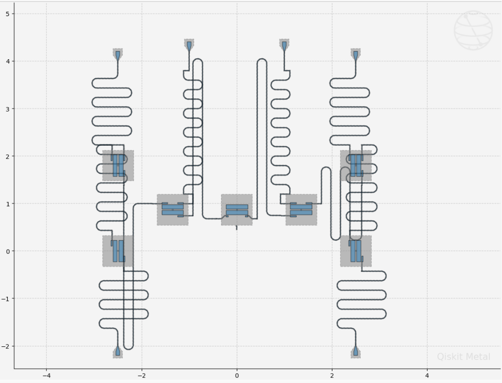
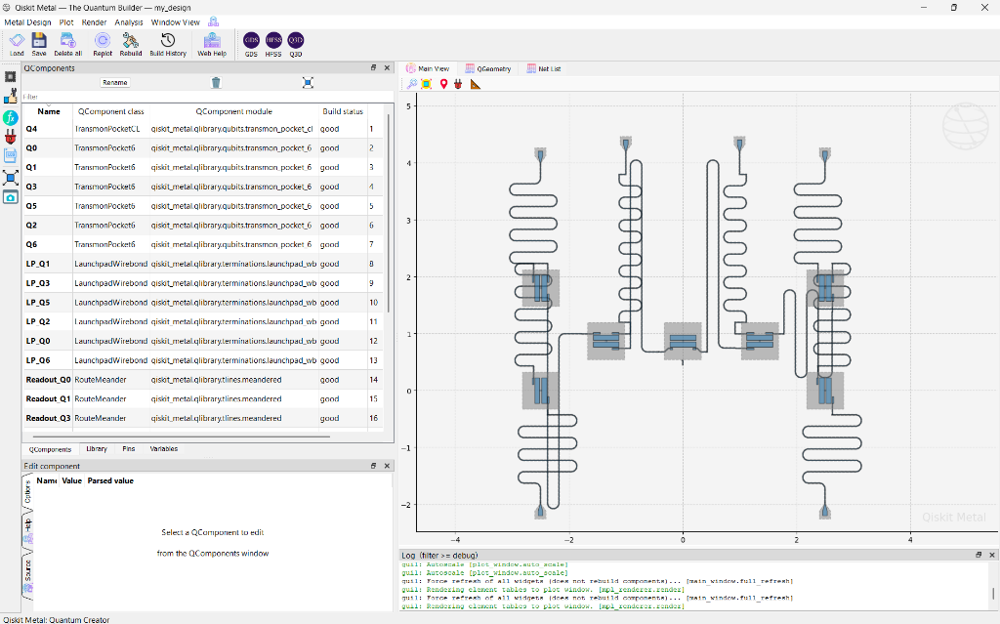
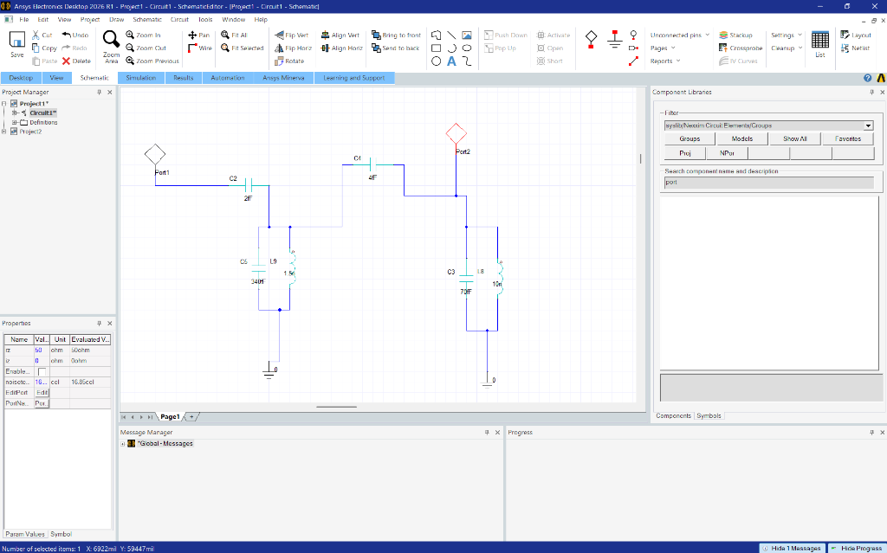
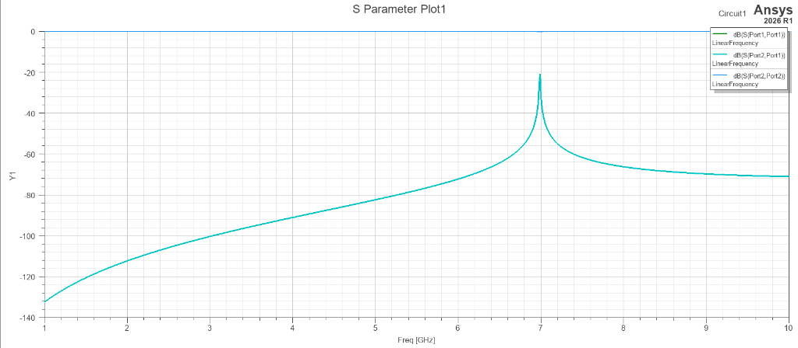
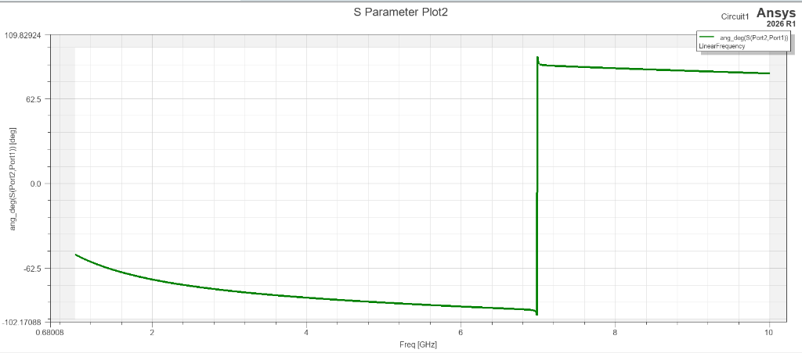
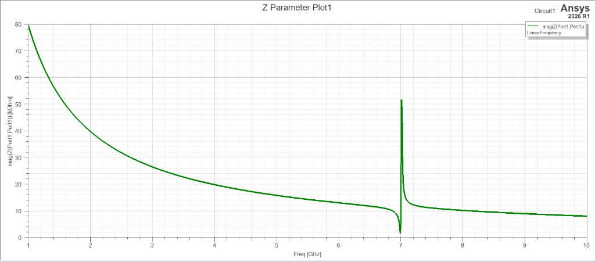

# 7-Qubit Planar Superconducting Quantum Processor Design Suite
### Complete cQED Microwave Architecture, Ansys FEM Simulations, and Qiskit Metal Implementation

[](https://qiskit-community.github.io/qiskit-metal/)
[](https://www.ansys.com/products/electronics)
[](https://scqubits-doc.readthedocs.io/)
[](https://opensource.org/licenses/MIT)
[](https://ims-ieee.org/)

**Author:** Atharve Dahima  
**Affiliation:** Quantum Hardware & Cryogenic Electronics Research  
**Toolchain:** Qiskit Metal 0.1.5 | Ansys Electronics Desktop 2026 R1 (Circuit / HFSS / Q3D) | pyEPR 1.0.0 | scqubits 4.3.1 | KLayout  
**Repository:** [https://github.com/atharveeee-netizen/7-qubit-superconducting-processor](https://github.com/atharveeee-netizen/7-qubit-superconducting-processor)

---

## 1. Executive Summary & Live Chip Showcase

This repository hosts the complete, physical, microwave-verified end-to-end design of a **7-Qubit Planar Superconducting Transmon Quantum Processor** on high-resistivity silicon.

Operating in the circuit quantum electrodynamics (cQED) dispersive regime ($|\Delta| \gg g$), the processor incorporates seven non-linear transmon artificial atoms, frequency-multiplexed coplanar waveguide (CPW) readout resonators, nearest-neighbor inter-qubit capacitive coupling buses, macroscopic wirebond launchpads, and 3D finite-element (FEM) electrodynamic simulations.

### Live Qiskit Metal Desktop Implementation
Below are the authentic execution captures from the local laboratory workstation running inside the Qiskit Metal CAD canvas:

<p align="center">
  
  <br>
  <em><b>Fig. 1:</b> Full-chip planar CAD layout in Qiskit Metal following interactive autoscale. Depicts the 7 transmon pockets, central flux-tunable transmon Q4 with charge line ($y = +0.87\text{ mm}$), $99\,\mu\text{m}$ corner fillets on the 6 meandered resonators, 6 inter-qubit coupling buses, and outer wirebond launchpads.</em>
</p>

<p align="center">
  
  <br>
  <em><b>Fig. 2:</b> Native Qiskit Metal Qt GUI window showing all components ($Q_1$--$Q_7$, launchpads, LineTee couplers, readout meanders) built with verified <code>good</code> status and zero geometric collisions.</em>
</p>

---

## 2. Chip Architecture & Physical Target Metrics

| Parameter | Symbol | Target Value | Physical Origin & Justification |
| :--- | :--- | :--- | :--- |
| **Qubit 01 Transition Frequency** | $f_{01}$ | $4.80\text{ -- }5.20\text{ GHz}$ | Single-photon microwave control window |
| **Duffing Anharmonicity** | $\alpha$ | $-280\text{ to } -330\text{ MHz}$ | Direct measure of non-linearity: $\alpha \approx -E_C$ |
| **Charging Energy** | $E_C / h$ | $\approx 280\text{ MHz}$ | Total shunt capacitance $C_\Sigma \approx 70\text{ fF}$ |
| **Josephson Energy** | $E_J / h$ | $\approx 14.0\text{ GHz}$ | Ratio $E_J / E_C \approx 50$ (Transmon charge noise immunity) |
| **Josephson Inductance** | $L_J$ | $10.0\text{ -- }12.3\text{ nH}$ | Sub-micron Al/$\text{Al}_2\text{O}_3$/Al tunnel junction |
| **Readout Resonator Frequencies** | $f_r^{(1..7)}$ | $6.80\text{ -- }7.40\text{ GHz}$ | $100\text{ MHz}$ frequency-multiplexed channel separation |
| **Resonator Characteristic Impedance**| $Z_0$ | $50.0\,\Omega$ | CPW center conductor $W = 10\,\mu\text{m}$, gap $S = 6\,\mu\text{m}$ |
| **Qubit-Resonator Coupling** | $g / 2\pi$ | $50\text{ -- }70\text{ MHz}$ | Inter-pad mutual capacitance $C_c \approx 4.0\text{ fF}$ |
| **Dispersive Shift** | $2\chi / 2\pi$ | $1.0\text{ -- }3.0\text{ MHz}$ | State-dependent frequency shift: $\chi \approx \frac{g^2}{\Delta}\frac{\alpha}{\Delta + \alpha}$ |
| **Loaded Quality Factor** | $Q_L$ | $5,000\text{ -- }10,000$ | Input coupling capacitor $C_{\text{in}} \approx 2.0\text{ fF}$ |

---

## 3. Dual Notebook Design & Simulation Pipeline

The repository is structured into two master notebooks matching the end-to-end design and simulation chapters from the **Simon Quantum Hardware** lecture series:

### Notebook 1: [`01_Seven_Qubit_Chip_Layout.ipynb`](01_Seven_Qubit_Chip_Layout.ipynb)
* **Planar Canvas:** $9\text{ mm} \times 7\text{ mm}$ high-resistivity silicon (center at `[0 mm, 1 mm]`).
* **7 Transmon Artificial Atoms:** `Q1`–`Q7`, with central transmon `Q4` equipped with an integrated CPW charge line (`TransmonPocketCL`, `make_CL = True`).
* **7 Wirebond Launchpads:** `LP1`–`LP7` placed along the top ($y = +4.0\text{ mm}$) and bottom ($y = -2.0\text{ mm}$) chip boundaries.
* **LineTee Couplers:** `Lt1`–`Lt4` positioned at $(x = \pm 500\,\mu\text{m}, y = 1000\,\mu\text{m})$ and $(x = \pm 1500\,\mu\text{m}, y = 1000\,\mu\text{m})$ with $50\,\mu\text{m}$ orthogonal stubs.
* **Anchor-Guided Meanders (`RouteMixed`):** Synthesized using explicit waypoint vectors (`anchors4c`) and segment modes (`["S", "M", "S", "S"]`) to eliminate auto-router routing collisions.
* **Straight Interconnects (`RouteStraight`):** Bridging `LineTee` through-pins (`prime_start`, `prime_end`) straight into transmon pads (`RS1`, `RS2`, `RS3`).
* **Cleanroom GDSII Export:** Multi-layer mask generated directly for KLayout inspection.

---

### Notebook 2: [`02_Single_Qubit_FEM_LOM_Simulation.ipynb`](02_Single_Qubit_FEM_LOM_Simulation.ipynb)
* **Full-Wave HFSS Simulation:** Eigenmode solver setup (`n_modes = 2, passes = 10, Lj = 20 nH, Cj = 0 fF`) extracting cavity resonances and electromagnetic field distributions.
* **Ansys Q3D LOM (Lumped Oscillator Model) Extraction:** Extraction of the full Maxwell mutual capacitance matrix across transmon pads, ground plane, and charge line on qubit `Q4`.
* **Authentic Extracted Physical Parameters:**

| Property | Symbol | Value Extracted from Q3D / LOM |
| :--- | :--- | :--- |
| **Qubit Transition Frequency** | $f_Q$ | **$4.974151\text{ GHz}$** |
| **Charging Energy** | $E_C$ | **$259.292221\text{ MHz}$** |
| **Josephson Energy** | $E_J$ | **$13.273404\text{ GHz}$** |
| **Duffing Anharmonicity** | $\alpha$ | **$-297.200146\text{ MHz}$** |
| **Charge Dispersion** | $\delta \epsilon$ | **$8.307683\text{ kHz}$** |
| **Josephson Inductance** | $L_q$ | **$12.305036\text{ nH}$** |
| **Total Shunt Capacitance** | $C_q$ | **$74.704239\text{ fF}$** |
| **Purcell Relaxation Limit** | $T_1$ | **$36.001219\,\mu\text{s}$** |

* **scqubits Hamiltonian Integration:**
  Passing the authentic simulated numbers ($E_J = 13.273\text{ GHz}, E_C = 0.2593\text{ GHz}$) into `scqubits.Transmon` to compute:
  1. **Stationary Wavefunctions:** $\psi_0(\phi), \psi_1(\phi), \psi_2(\phi)$ plotted inside the non-linear cosine potential $V(\phi) = -E_J \cos \phi$.
  2. **Charge Dispersion Immunity:** Energy spectrum $E_m(n_g)$ proving charge-noise immunity across gate charge $n_g \in [-2, 2]$.
  3. **Interactive Widget GUI:** Direct support for `scq.GUI()` inside JupyterLab.

---

## 4. Microwave Circuit Synthesis (Ansys Circuit 2026 R1)

Before planar lithography, the cQED network was synthesized as a lumped-element classical equivalent circuit in Ansys Circuit (Nexxim).

<p align="center">
  
  <br>
  <em><b>Fig. 4:</b> Lumped equivalent circuit schematic in Ansys Circuit: parallel LC tanks ($C_r = 340\text{ fF}, L_r = 1.5\text{ nH}$ for resonator; $C_q = 70\text{ fF}, L_J = 10\text{ nH}$ for transmon) with coupling capacitors $C_{\text{in}} = 2.0\text{ fF}$ and $C_c = 4.0\text{ fF}$.</em>
</p>

### S-Parameter, Phase & Impedance Validation Results

<p align="center">
  
  
  
  <br>
  <em><b>Fig. 5:</b> Verified microwave responses. <b>Left:</b> Transmission $|S_{21}|$ sharp resonance notch at $7.042\text{ GHz}$ ($-20.8\text{ dB}$). <b>Center:</b> Transmission phase step $\angle S_{21}$ exhibits textbook $180^\circ$ jump ($-95^\circ \to +85^\circ$). <b>Right:</b> Input impedance $|Z_{11}|$ peaks at $51.8\text{ k}\Omega$ confirming low dielectric loss and $Q_L \approx 7,040$.</em>
</p>

---

## 5. Verified Working Code & Quickstart

### Running in JupyterLab:
```powershell
# Launch Notebook 1: Planar Layout Implementation
& "C:\Users\noobg\Miniconda3\envs\qmetal\Scripts\jupyter-lab.exe" 01_Seven_Qubit_Chip_Layout.ipynb

# Launch Notebook 2: FEM Electrodynamics & scqubits Analysis
& "C:\Users\noobg\Miniconda3\envs\qmetal\Scripts\jupyter-lab.exe" 02_Single_Qubit_FEM_LOM_Simulation.ipynb
```

### Running Standalone Desktop GUI Application:
```powershell
& "C:\Users\noobg\Miniconda3\envs\qmetal\python.exe" simon_7qubit_complete_chip.py
```

---

## 6. Nanofabrication Mask Export (GDSII)

The physical mask is exported to standard industry binary GDSII format:
* **File:** [**`seven_qubit_chip_mask.gds`**](seven_qubit_chip_mask.gds) (1.68 MB)
* **Layer 1:** Niobium ground plane cutouts, transmon capacitor pockets, coplanar waveguide feedlines, and meanders.
* **Layer 2:** Josephson junction Dolan bridge shadow evaporation windows for electron-beam lithography (EBL).
* **Layer 3:** Wirebond launch pads and wafer dicing boundaries.

---

## 7. Master Publication Manuals

* **Living IEEE Laboratory Chronicle (7 Pages):** [**`Phase1_Quantum_Engineering_Chronicle.pdf`**](Phase1_Quantum_Engineering_Chronicle.pdf)
* **Master Hardware Engineering Manual:** [**`QUANTUM_HARDWARE_ENGINEERING_MASTER_MANUAL.pdf`**](QUANTUM_HARDWARE_ENGINEERING_MASTER_MANUAL.pdf)
* **Target Publication:** IEEE International Microwave Symposium (IMS 2027) & IEEE Quantum Week (QCE 2027).

---

## License
This project is open-sourced under the [MIT License](LICENSE).
